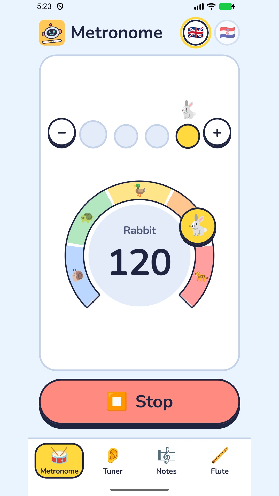
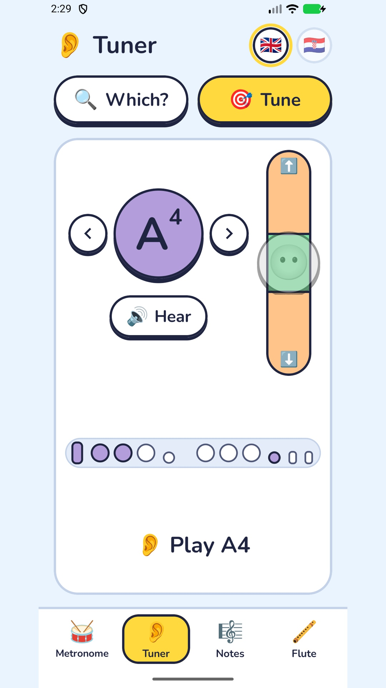
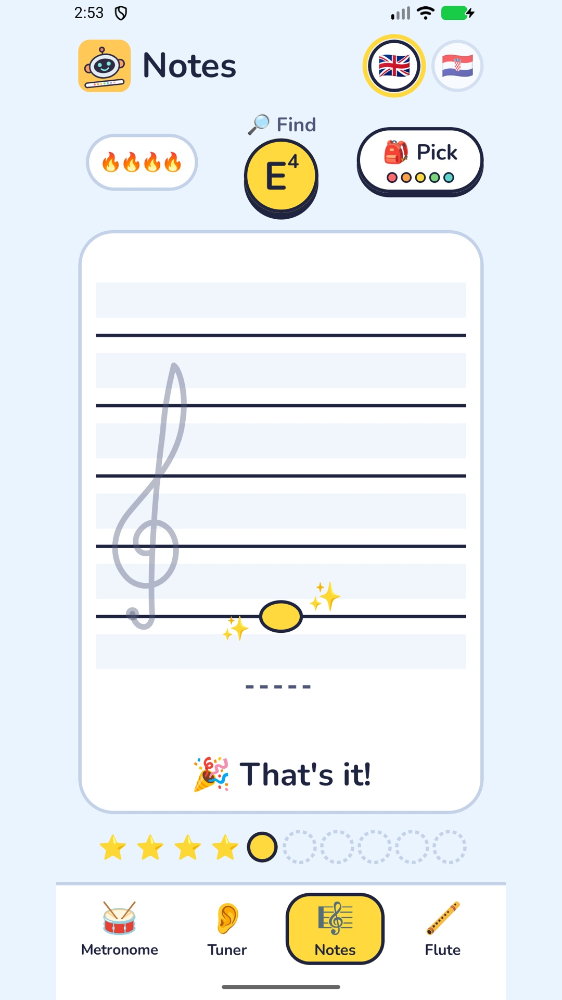
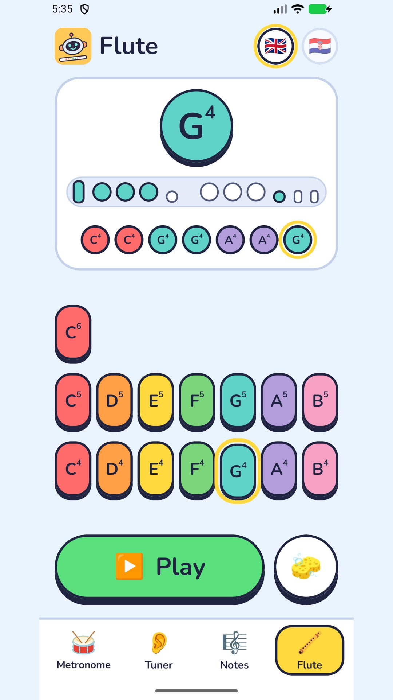

# Flute Assistant

An Android app for primary-school children learning the flute. It has a metronome, a chromatic
tuner, a note reading game and a digital flute, in English and Croatian.

<p align="center">
  
  
  
  
</p>

## What it does

| Tab       | What the child does                                                                                                                                                                                                                                                            |
|-----------|--------------------------------------------------------------------------------------------------------------------------------------------------------------------------------------------------------------------------------------------------------------------------------|
| Metronome | Drags a tempo ring or picks a level (Beginner, Learner, Star, Master), steps through ten time signatures (2/2, 2/4 up to 12/8), and watches the beat dots bounce. The click keeps going while the phone is in a pocket or another app is open, with a notification to stop it. |
| Tuner     | Plays a note and sees its name in large letters, with "Perfect!", "Too low" or "Too high" and one tip on what to change. Or picks the note to play, hears it, sees the fingering and tunes to it.                                                                              |
| Notes     | Reads a note name and taps its place on the treble staff. Ten notes a round, a streak for hits in a row, the score at the end. The child chooses which notes to practise.                                                                                                      |
| Flute     | Holds down any of fifteen keys, from middle C up two octaves, to sound a note. The fingering is drawn, the notes played are collected in a line, and the tune plays back.                                                                                                      |

The screens show no numbers or jargon: no BPM, hertz or cents. Tempo is a named level, tuning is a
gauge with coloured zones, and the game's score is a row of dots until the round summary. The
metronome engine already supports tap tempo, subdivisions, click sounds and presets, and the tuner
supports other A4 references. None of that is exposed, and it is kept for a later advanced mode.

The app asks for no account and has no network permission, analytics or ads. The microphone is open
only while the tuner tab is on screen, and the audio is analysed in memory and discarded. Settings
and the child's tune stay on the device. The [privacy policy](docs/release/privacy-policy.md) says
the same in full.

## At a glance

|                 |                                                                                                                    |
|-----------------|--------------------------------------------------------------------------------------------------------------------|
| Platform        | Android, minSdk 24, targetSdk 37                                                                                   |
| Language and UI | Kotlin, Jetpack Compose, Material 3                                                                                |
| Architecture    | MVVM with `StateFlow`, Hilt, Room, coroutines and Flow                                                             |
| Audio           | Own DSP on `AudioTrack` and `AudioRecord`: click synthesis, YIN pitch detection, a sustained-tone synth            |
| Dependencies    | AndroidX, plus Hilt and kotlinx.coroutines. No audio, networking or image libraries                                |
| Size            | About 7,400 lines of app code and 4,300 lines of tests (about 220 JVM unit tests, about 70 instrumented)           |
| Languages       | English and Croatian, switchable in the app                                                                        |
| Status          | 1.0.1 is on the Play internal testing track and a GitHub Release. Store listing in both languages is ready         |

## Architecture

The code is layered by package under `app/src/main/java/hr/bertlab/fluteassistant/`:

```
domain/    pure Kotlin: models, note math, tap tempo, the note pool, repository interfaces, use cases
data/      Room and SharedPreferences implementations of those interfaces
audio/     metronome, tuner and flute-tone engines
playback/  foreground service that keeps the metronome alive off screen
ui/        Compose screens and ViewModels (StateFlow state, intent methods)
di/        Hilt modules binding each interface to its Android implementation
core/      fake-able monotonic clock, logger
```

Each screen is a stateful composable (ViewModel, permissions, lifecycle) wrapped around a stateless
`*Content` composable that takes state and callbacks. The UI tests render the `Content` composables
directly. All ViewModels are Activity-scoped, so state and playback survive tab switches, rotation
and the Activity re-creation that a language switch causes.

## Metronome timing

```
MetronomeConfig -> ClickScheduler -> MetronomeRenderer -> AudioTrackMetronomePlayer
```

`ClickScheduler` produces a sample-accurate click timeline. Positions accumulate as doubles, so
rounding does not drift, and a tempo change moves the click that is already scheduled instead of
restarting the bar. `MetronomeRenderer` mixes the active click voices into PCM blocks, caches the
synthesised samples and runs everything through a soft limiter. The player is a dedicated
`URGENT_AUDIO` thread doing blocking float-PCM writes to a low-latency streaming `AudioTrack`. It
stops on audio-focus loss and when headphones are unplugged.

The scheduler, renderer and synth have no Android dependencies and are tested on the JVM.

Every beat event carries a session id and the time the click will be heard, derived from
`AudioTrack.getTimestamp`. The UI holds the beat flash until that moment, so what the child sees
lines up with what they hear, and it drops events from sessions that have ended. Session end is an
event flow rather than state, because a session can start and fail within a single frame.

The player is an app-wide singleton. `MetronomeService` owns nothing: it shows a media-playback
notification mirroring the player's state, stops itself when playback ends, and returns
`START_NOT_STICKY` so the system never revives a metronome nobody started.

## Tuner

`AudioRecord` (the `UNPROCESSED` source when the device has it, 4096-sample windows advanced by
2048) feeds a pure-Kotlin YIN detector, and the ViewModel decides what the child gets to see:

- The detector searches only one semitone beyond the flute's range, so a voice or mains hum below
  middle C cannot register as a note, and a silence gate sits at about -60 dBFS.
- A reading is published once the last three frames (about 130 ms) agree within 30 cents. The shown
  value is the median of five frames, held for about 0.9 s through silence or an unsteady pitch
  before it clears.
- In target mode the reading is measured against the note the child chose. Within 70 cents of that
  note or its octaves it still counts as that note, so a note played sixty cents flat reads "Too
  low" and is not renamed as its neighbour.
- "In tune" is 10 cents wide, twice a professional tuner's window, because it is judging a beginner.
  The thresholds live in one place and the gauge draws its zones from them. There is no tolerance
  setting on purpose.

The confidence gate is an open question, and the code says so. Offline analysis against recordings
of a real flute with breath noise added showed that below roughly 9 dB signal-to-noise the detector
still finds the note, while the second of two stacked confidence gates discards the frame and the
screen shows nothing. The gate stays at 0.85 until a capture from a phone confirms it. The KDoc on
`MIN_PROBABILITY` names the log line to read and the change the evidence supports, and the analysis
is written up in the tuner spec.

## Flute synth

`FluteTimbre` supplies the harmonics and `SustainedToneSynth` renders them with a phase-continuous
oscillator and an envelope: 30 ms attack, 120 ms release and a 10 ms fade when a key is retriggered.
A key press, a release or a takeover by the next key never clicks. `AudioTrackFluteTonePlayer`
streams from an `URGENT_AUDIO` thread like the metronome, writing silence while nothing is held and
every block in full.

On close, the thread lets a sounding note release and plays out the buffer before it gives the track
back. A new `open()` meanwhile starts its own track, so after a rotation the first key press does
not wait for the old one. The render loop is plain Kotlin so this close path is unit-tested.

## Testing

- Unit tests use hand-written fakes (`FakeMetronomePlayer`, `FakeTunerEngine`, `FakeSettingsStore`,
  `FakeClock`, `FakeFluteTonePlayer` and others) and no mocking library.
- ViewModel tests run under `StandardTestDispatcher` and drive time with `advanceTimeBy`.
- Instrumented tests render each `Content` composable with the locale pinned, and a resource test
  checks that labels and note names follow the locale.
- Audio output cannot be judged in CI. The emulator runs with `-no-audio` because with host audio on
  it crashed about 30 s after the metronome started, so sound is checked on a phone.

## Observability

`core/log/Logger` is the only way to log. Each line is a dotted event name plus `key=value` fields,
under one tag per subsystem (`FA.Tuner`, `FA.Metronome`, `FA.Playback`, `FA.Flute`), so lines can be
grepped and split on spaces. Event names are treated as an interface and kept stable. Per-frame
detail is off unless switched on per tag at runtime, in any build. The tuner writes one
`tuner.summary` line about every second with counts per frame decision, probability against the gate
and the input level, which is enough to tell from one logcat capture whether frames are being
rejected as silent, unclear or low-confidence.

```sh
adb logcat -v time -s FA.Tuner | grep tuner.summary
adb shell setprop log.tag.FA.Tuner VERBOSE
```

## Localisation

`AppCompatDelegate.setApplicationLocales` provides per-app language back to minSdk 24, with the
platform storing the choice on Android 13 and later. `localeFilters` strips every library locale
except English and Croatian. Domain enums stay language-free, and `ui/common/Labels.kt` maps them to
string resources. Note naming follows the locale: scientific notation (C4) in English, the
music-school convention (c1) and German H and B in Croatian.

## Build and release

- Android Gradle Plugin 9.4.1 with its built-in Kotlin. The root build raises AGP's bundled Kotlin
  to the version in the catalog, and the Compose compiler plugin shares that version. Gradle 9.8.2
  is pinned by checksum and the configuration cache is on.
- Release builds use whole-app R8. A package-scoped optimisation was tried first and crashed at
  startup inside `androidx.startup`.
- Signing credentials come from environment variables or a gitignored `keystore.properties`. With
  neither, the release build is produced unsigned so the project compiles anywhere. The keystore
  backup procedure is in [`docs/release/`](docs/release/README.md).
- GitHub Actions (`.github/workflows/release.yml`) runs the unit tests and release lint on every push
  to `main`, builds a signed bundle and APK, and checks that both carry the upload certificate. When
  `fluteAssistant.versionName` in `gradle.properties` has no `v<name>` tag yet, the run is a
  release: the bundle goes to the Play internal testing track through Workload Identity Federation
  (no key file), then the commit is tagged and a GitHub Release gets the bundle, the APK and the R8
  mapping file. `tools/release.sh` derives the version code from the name (major * 10000 + minor *
  100 + patch). Build, Play upload and release are separate jobs, so "Re-run failed jobs" repeats
  only what failed.
- Launcher icons and store graphics are generated from source (`tools/IconGen.java`), and the store
  screenshots, one per tab in each language, come from `tools/play-screenshots.sh` driving an
  emulator.

```sh
./gradlew assembleDebug
./gradlew testDebugUnitTest
./gradlew :app:connectedDebugAndroidTest      # emulator or device attached
./gradlew testDebugUnitTest lintRelease bundleRelease
```

## How features are built

Each feature has a design spec and an implementation plan, written before the code and revised as
decisions changed, including the layouts that were tried and rejected. They are kept outside the
repository. Features are written and implemented with an AI coding agent. [`CLAUDE.md`](CLAUDE.md) holds the working rules for that agent and the most detailed
description of the internals, kept in step with the code.

## Known limits

- Instrumented tests do not run in CI. They are run by hand on an emulator or a phone.
- Moving a build from internal testing to a closed test or production is done by hand in Play
  Console.
- Sound quality and the -60 dBFS silence gate can only be confirmed on a phone, and the tuner's
  confidence gate is waiting for such a capture.
- Room is at schema version 1 with a destructive fallback migration. Presets are not exposed, so no
  user data is stored there today, but a migration has to be written before they ship.
- Tap tempo, subdivisions, click sounds, presets and the A4 reference are built but have no screen.
  The advanced mode that would hold them is not started.
